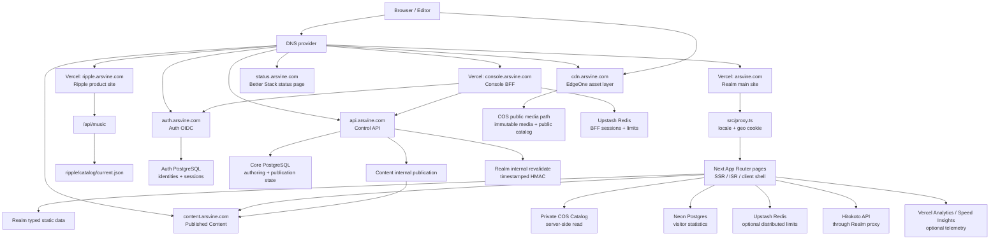

# 全系统地图与分布架构

[返回文档组](./README.md)

本文是 ARSVINE 系列站点当前的跨仓库系统地图。Realm 单仓库的组件分层和受保护文章细节以 [`human/ARCHITECTURE.md`](../human/ARCHITECTURE.md) 与 [`human/SECURITY.md`](../human/SECURITY.md) 为准。

当前公开探针（2026-10-17）：`console`、`auth`、`api`、`content`、`ripple` 的 live/ready 返回 200；`status.arsvine.com` 返回 200；Realm `/api/health/*` 受 Vercel Bot Protection 返回 429。共享拓扑由 Platform `@arsvine/site-config` 拥有，经同步包进入 Realm/Ripple。

## 一句话模型

系统由 **Realm / Ripple 展示面**、Console 控制面、Auth 身份面、API 写作面、Content 发布读面、CDN 资产面和 Status 观测面组成：Console 经 OIDC 调 API 写入 Core，再发布到 Content；Realm 服务端读 Content；Ripple 读 CDN 上独立的 `ripple/` catalog（投影自 Realm 音频权威）；浏览器媒体走 `cdn.arsvine.com`。

## 全局拓扑

Status 是业务系统之外的观测面。核心业务服务不依赖 Status 处理请求。

Realm 对 Content 的读取发生在 Next.js 服务端（`@arsvine/site-config` 中的 Content origin）。浏览器 Network 通常只看到 `arsvine.com`。Ripple 音乐 API 同源暴露，目录对象在 `cdn.arsvine.com/ripple/`。

## 运行单元与责任

| 单元          | 仓库/入口                                         | 运行位置                                      | 主要责任                                          | 当前状态                                                                                         |
| ------------- | ------------------------------------------------- | --------------------------------------------- | ------------------------------------------------- | ------------------------------------------------------------------------------------------------ |
| Realm 主站    | `Arsvine-Devs/realm`                              | `arsvine.com`，Vercel                         | 作品集、博客、推文、受保护内容、资产 Catalog      | `CURRENT`+`LIVE`；源码基线 `17a809f`；health 429；生产 deployment SHA 标 `UNKNOWN`（未读控制台） |
| Ripple 产品站 | `Arsvine-Devs/ripple-website`                     | `ripple.arsvine.com`，Vercel `arsvine-ripple` | 产品体验、公开 music API、独立 `ripple/` CDN 发布 | `CURRENT`+`LIVE`；catalog `20261015T152226Z`                                                     |
| Console       | `platform/apps/console`                           | `console.arsvine.com`                         | OIDC BFF、内容管理 UI                             | `CURRENT`+`LIVE`                                                                                 |
| Auth          | `platform/apps/auth`                              | `auth.arsvine.com`                            | Better Auth、OIDC、Passkey、TOTP                  | `CURRENT`+`LIVE`                                                                                 |
| API           | `platform/apps/api`                               | `api.arsvine.com`                             | Core authoring、发布编排、Realm revalidate        | `CURRENT`+`LIVE`                                                                                 |
| Content       | `platform/apps/content`                           | `content.arsvine.com`                         | published release 读与内部 publication            | `CURRENT`+`LIVE`                                                                                 |
| 共享契约包    | `platform/packages/site-config`、`service-health` | 同步至 Realm/Ripple `packages/`               | 固定拓扑、health payload                          | `CURRENT`                                                                                        |
| Asset/CDN     | Realm/Ripple 发布脚本、COS、EdgeOne               | `cdn.arsvine.com`                             | 不可变对象 + pointer                              | `CURRENT`+`LIVE`                                                                                 |
| Status        | Better Stack                                      | `status.arsvine.com`                          | 外部健康展示                                      | `LIVE`+`CLAIMED`                                                                                 |
| Realm 数据    | Neon visitor-stats                                | Neon                                          | 访客计数                                          | `CURRENT`；branch `UNKNOWN`                                                                      |
| Platform 数据 | Neon Auth/Core                                    | Neon                                          | identity + authoring                              | `CURRENT`；branch `UNKNOWN`                                                                      |

## Realm 主站内部边界

### 请求与渲染

Realm 的根入口是 `src/app/layout.tsx`，在 `[locale]` 之上保持全局 client shell。`src/app/[locale]/layout.tsx` 处理 locale 验证、服务端 `next-intl` 和 locale metadata。主要页面使用静态数据、动态服务端读取或 300 秒 ISR；Route Handler 集中在 `src/app/api/`，当前使用 Node runtime/dynamic handler。

`src/proxy.ts` 负责 locale redirect、受支持 locale 放行和 `GEO_COUNTRY` Cookie。它通过 `@vercel/functions` 读取 Vercel Geo；自托管时需要由反向代理或应用层提供明确的等价策略。

### 领域层

`src/features/` 按领域持有 `contracts`、`model`、`server`、`ui` 和 `styles`；`src/shared/` 只保留跨 feature 的稳定能力。

| 数据类别                               | 当前所有者                                                       | 读取方式                                                  |
| -------------------------------------- | ---------------------------------------------------------------- | --------------------------------------------------------- |
| 作品、经历、Life、技能、友链、站点配置 | Realm `src/features/*/contracts/` 与 `src/shared/config/site.ts` | 构建时/服务端静态 registry                                |
| 博客索引和 MDX 正文                    | Content release / COS objects                                    | Realm 服务端通过 `content.arsvine.com` 读取               |
| 推文月索引与月度 JSON                  | Content release / COS objects                                    | Realm 服务端通过 Content API 读取并按 `visibility` 过滤   |
| 图片、音频、字体和装饰对象             | COS public media path                                            | 浏览器使用 `cdn.arsvine.com` 的 `objectKey`               |
| Catalog 元数据                         | COS private Catalog                                              | Realm 服务端读取 `current.json` 后校验 versioned sections |
| 访客计数                               | Realm Neon database                                              | `/api/visitor-stats` 使用匿名签名 Cookie 和 HMAC key      |

### 主要失效隔离

- Content release/API 不可达时，Realm 使用 Content client 错误边界。
- Private Catalog 不可用时，资产 API 保留 `502` 与空 Catalog 的区别；页面使用 feature fallback。
- Upstash 未配置或暂时不可达时，限流退回单进程 Map；多实例场景不提供全局限流保证。
- Hitokoto 失败时回退到预设文案；Telemetry 和 WebGL 失败不阻断基础 UI。
- 受保护博客首次页面只给清理后的 metadata，正文由授权后的 runtime API 加载。

## Vercel 项目设置与生产 deployment

| Vercel project    | rootDirectory  | 说明                       |
| ----------------- | -------------- | -------------------------- |
| `arsvine-realm`   | 空             | Next.js App Router         |
| `arsvine-ripple`  | 空             | Vite 静态站 + `/api/music` |
| `arsvine-admin`   | `apps/console` | Console BFF                |
| `arsvine-auth`    | `apps/auth`    | Auth                       |
| `arsvine-api`     | `apps/api`     | Control API → `dist`       |
| `arsvine-content` | `apps/content` | Content → `dist`           |

生产部署 SHA：Platform 四服务与 GitHub `main` `4479147` 对齐（`CLAIMED`/`LIVE`）；Realm/Ripple 生产 SHA 以 Vercel 控制面为准（`UNKNOWN` 直至复核）。默认分支为部署目标；日常开发在 `dev/<topic>`，经 PR 合入。

## 环境变量与固定拓扑

固定 service origin、OIDC、catalog namespace 与 publication pointer 由 Platform `@arsvine/site-config` 拥有，并同步到 Realm/Ripple `packages/site-config`。动态 secret 仍按各仓 `.env.example` / env contract。废弃历史键：`GITHUB_*`（内容不再从 GitHub 读取）、`REVALIDATE_SECRET`（现为 `REVALIDATE_WEBHOOK_SECRET`）、`NEXT_PUBLIC_CDN_BASE`（现为 site-config CDN origin）。

## 已验证的公开运行信号

- Platform `console`/`auth`/`api`/`content` `/health/live|ready` → 200。
- `ripple.arsvine.com/health/live|ready` 与 `/api/music` → 200；CDN music pointer 可读。
- Realm `/api/health/*` → 429（Bot Protection）。
- `status.arsvine.com` → 200。

## 当前待确认事项

- Neon 资源的实际 database、branch、备份策略和连接归属仍需从 Neon 控制面确认；当前资源映射为 `neon-pink-ball`→Realm、`neon-camel-candle`→Console/Auth/API。
- Vercel preview protection、各项目 Git 自动部署规则和 deployment protection 的完整设置仍需从对应控制面确认；项目构建设置和当前 production deployment 已确认。
- DNSPod zone 记录、证书绑定与续期控制面的完整当前状态仍需从 DNSPod/腾讯云控制面确认。
- Better Stack 的实际 monitor 列表、探针路径、通知渠道和告警阈值仍需从 Status 控制面确认。
- Realm canonical health 路由受到 Bot Protection challenge；Status 的检测配置需要使用已允许的探针策略或其他可验证的 deployment health 入口。
